# Arturo Ruedas


> **Proyecto académico archivado — repositorio demostrativo.**
> Proyecto de grado del Tecnólogo en Análisis y Desarrollo de Software (SENA), desarrollado entre marzo y septiembre de 2025
> por el equipo **BICOPS**. Este repositorio muestra qué hacía la aplicación y cómo estaba construida; no está desplegada
> ni conectada a ningún servicio.

**Arturo Ruedas** es una app móvil tipo marketplace para ciclistas: reúne en un solo lugar la compra y venta de bicicletas
y componentes, la visualización de bicicletas en 3D, guías técnicas por componente y un asistente con inteligencia artificial.

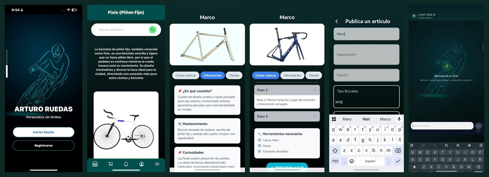

## Funcionalidades

- **Cuenta de usuario**: registro con foto de perfil, inicio de sesión, edición de perfil, cambio de contraseña y recuperación
  por código enviado al correo.
- **Catálogo por estilo** (ruta, MTB y piñón fijo): descripción de cada tipo, modelo 3D interactivo y búsqueda de artículos
  por nombre y componente.
- **Visor 3D**: modelos GLB de las tres bicicletas que se pueden rotar y acercar (Three.js / React Three Fiber).
- **Detalle de componentes**: qué es, mantenimiento, curiosidades y guía paso a paso de cómo colocarlo, con herramientas necesarias.
- **Publicar y vender**: publicación de artículos con fotos (Supabase Storage), carrito, contacto por WhatsApp con el vendedor
  y otras publicaciones del mismo vendedor.
- **Notificaciones push**: cuando un artículo se marca como vendido, se avisa a los usuarios que lo tenían en el carrito
  (Expo push); historial de notificaciones en la app.
- **Asistente IA**: chat con GPT-4o para resolver dudas sobre bicicletas y componentes.
- **Panel de administración**: listado de usuarios y publicaciones, filtros y eliminación.

## Capturas

| Presentación | Inicio de sesión | Elige tu estilo |
|:---:|:---:|:---:|
| 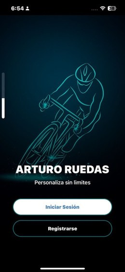 | 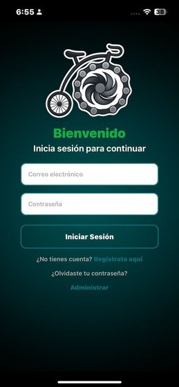 | 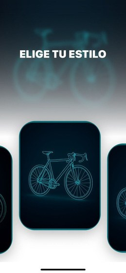 |
| **Catálogo (piñón fijo)** | **Búsqueda de componentes** | **Detalle de componente** |
| 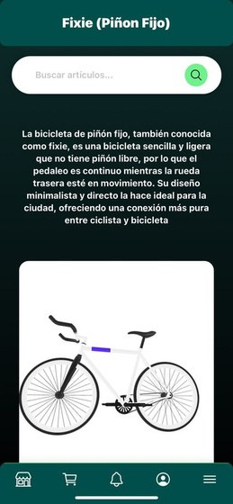 | 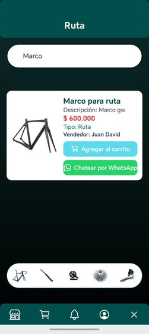 | 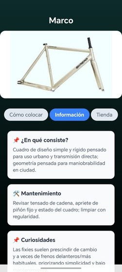 |
| **Guía "Cómo colocar"** | **Publicar artículo** | **Asistente IA** |
| 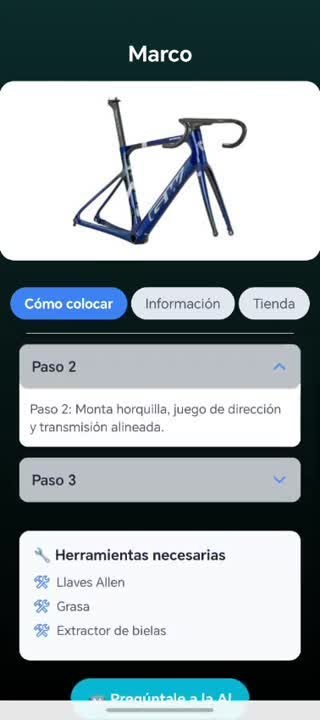 | 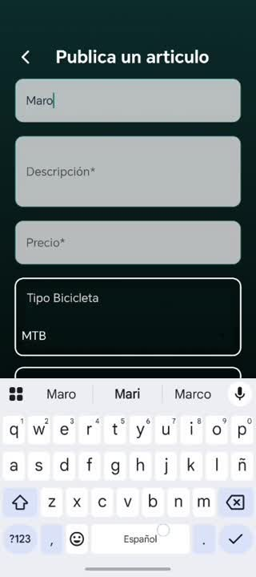 | 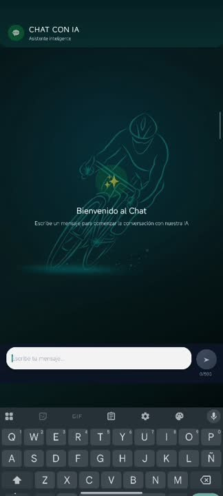 |

### Videos de la app

Tomados de la presentación del proyecto (cada GIF enlaza al video MP4 completo). En los videos se difuminó la pantalla
del teléfono en los tramos donde aparecían contactos y archivos personales.

**Comprar** — buscar un componente, agregarlo al carrito y contactar al vendedor por WhatsApp. [Ver video (MP4)](docs/videos/01-comprar.mp4)

[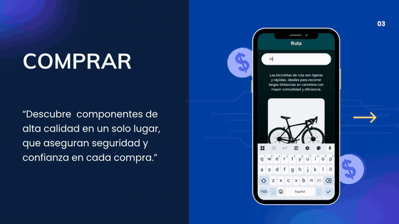](docs/videos/01-comprar.mp4)

**Vender** — publicar un artículo con sus datos y fotos desde la galería del teléfono. [Ver video (MP4)](docs/videos/02-vender.mp4)

[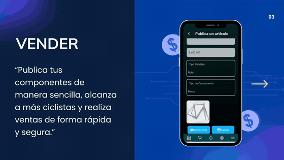](docs/videos/02-vender.mp4)

**Aprender más** — información del componente y guía paso a paso de cómo colocarlo. [Ver video (MP4)](docs/videos/03-aprende-mas.mp4)

[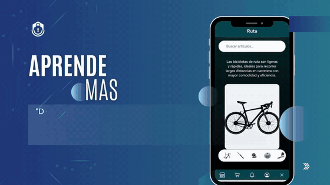](docs/videos/03-aprende-mas.mp4)

**Asistente con IA** — chat para resolver dudas sobre bicicletas y componentes. [Ver video (MP4)](docs/videos/04-asistente-ia.mp4)

[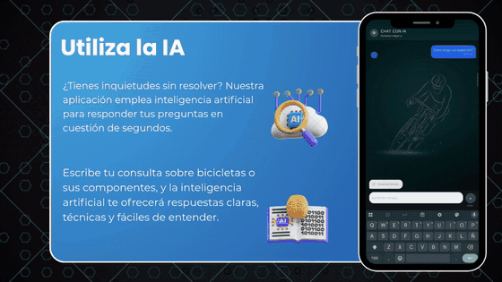](docs/videos/04-asistente-ia.mp4)

**Visor 3D** — recorrido por los estilos de bicicleta (MTB, ruta y piñón fijo) con modelos 3D. [Ver video (MP4)](docs/videos/05-visor-3d.mp4)

[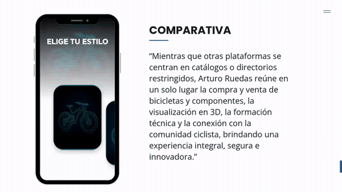](docs/videos/05-visor-3d.mp4)

### Presentación del proyecto

**Presentación del proyecto (PDF)** — el pitch completo de Arturo Ruedas (32 páginas): oportunidad de mercado, funcionalidades,
competencia y stack. [Abrir la presentación (PDF)](docs/presentacion/pitch-arturo-ruedas.pdf)

_Se omitió la página del equipo de desarrollo por privacidad; los créditos con nombres y roles están al final de este README._

## Stack

| Capa | Tecnología |
|---|---|
| App móvil | React Native + Expo, TypeScript, React Navigation, Context API + AsyncStorage |
| 3D | Three.js, React Three Fiber, Drei (modelos GLB) |
| API | Node.js + Express, TypeScript, `pg` |
| Base de datos y archivos | Supabase (PostgreSQL + Storage) |
| IA | OpenAI GPT-4o |
| Notificaciones | Expo push (`expo-server-sdk`) |
| Correo | Resend |

## Arquitectura

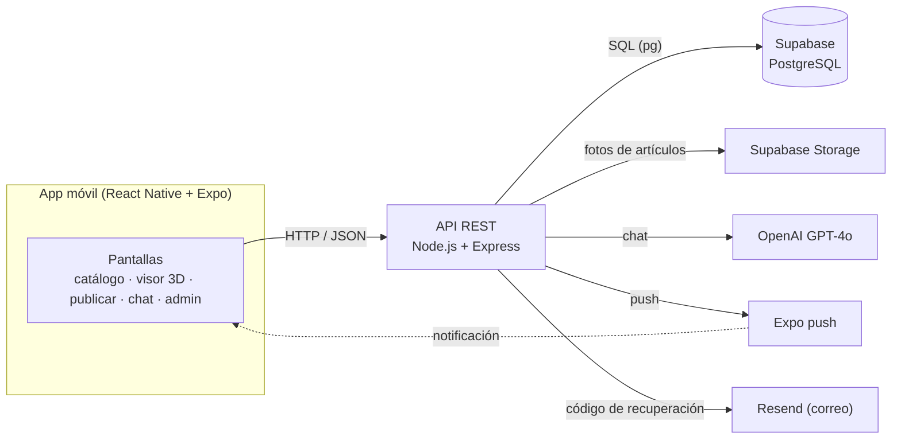

## Endpoints de la API

24 endpoints en [`backend/src/index.ts`](backend/src/index.ts):

| Método | Ruta | Descripción |
|---|---|---|
| POST | `/registrar` | Registro de usuario con foto de perfil |
| POST | `/iniciar-sesion` | Inicio de sesión |
| POST | `/enviar-correo-reset` | Envía el código de recuperación de contraseña |
| POST | `/restablecer-contrasena` | Cambia la contraseña con el código recibido |
| GET | `/buscar` | Busca artículos por nombre y tipo de bicicleta |
| POST | `/publicar_articulo` | Publica un artículo con fotos |
| POST | `/guardar-token` | Guarda el token de notificaciones del dispositivo |
| POST | `/notificaciones/guardar-notificacion` | Registra una notificación en el historial |
| POST | `/agregar-carrito` | Agrega un artículo al carrito |
| GET | `/carrito/:id_usuario` | Carrito del usuario |
| DELETE | `/eliminar-carrito` | Quita un artículo del carrito |
| POST | `/iniciar-administrador` | Inicio de sesión de administrador |
| GET | `/obtener-usuarios` | Lista de usuarios (admin) |
| GET | `/obtener-publicaciones/:ID_usuario` | Publicaciones de un usuario (admin) |
| DELETE | `/eliminar-usuario/:id` | Elimina un usuario (admin) |
| DELETE | `/eliminar-publicaciones-admin/:id` | Elimina una publicación (admin) |
| GET | `/obtener-publicaciones-usuario-logueado/:ID_usuario` | Publicaciones propias |
| DELETE | `/marcar-vendido/:id` | Marca como vendido, limpia carritos y notifica a los interesados (transacción) |
| POST | `/chat` | Consulta al asistente IA |
| GET | `/publicaciones` | Publicaciones filtradas por tipo y componente |
| GET | `/usuario/:id` | Datos de un usuario |
| PUT | `/EditarUsuario/:id` | Actualiza el perfil |
| PUT | `/CambiarContrasena/:id` | Cambia la contraseña |
| GET | `/PublicacionesRelacionadasVendedor/:ID_usuario` | Otras publicaciones del vendedor |

## Modelo de datos

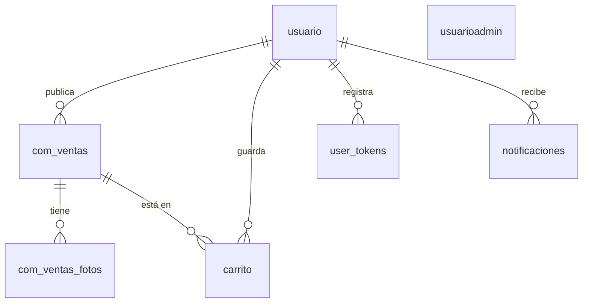

| Tabla | Contenido |
|---|---|
| `usuario` | Usuarios registrados y foto de perfil |
| `com_ventas` | Publicaciones de artículos (nombre, descripción, precio, tipo de bicicleta, componente) |
| `com_ventas_fotos` | Fotos de cada publicación |
| `carrito` | Artículos guardados por cada usuario |
| `user_tokens` | Tokens de Expo para notificaciones push |
| `notificaciones` | Historial de notificaciones ([`docs/sql/notificaciones.sql`](docs/sql/notificaciones.sql)) |
| `usuarioadmin` | Cuentas de administrador |

## Estructura

```
├── backend/            API Express (src/index.ts) y su .env.example
├── frontend/
│   ├── App.tsx         navegación principal
│   ├── components/     pantallas por módulo: inicio de sesión, bicicletas (3D), detalle y publicaciones,
│   │                   funciones de barra (carrito, notificaciones, publicar), perfil, administrador
│   ├── config/         URL de la API
│   ├── iconos/ img/    recursos gráficos
├── assets/modelos/     modelos 3D (fija.glb, mtb.glb, ruta.glb)
└── docs/               capturas y SQL
```

## Limitaciones conocidas

Este es el código tal como se entregó en 2025. Hoy haría distinto:

- **Contraseñas en texto plano**: se guardaban y comparaban sin cifrar. Hoy las guardaría con **bcrypt** (hash con salt) y
  compararía con `bcrypt.compare`, sin devolver nunca el hash en las respuestas.
- **Códigos de recuperación sin expiración**: el código se guardaba en memoria sin fecha de vencimiento. Hoy le pondría
  **expiración corta** (p. ej. 5–10 minutos), lo invalidaría al usarlo **una sola vez** y limitaría los intentos;
  además lo guardaría en la base de datos para que no se pierda si el servidor se reinicia.

## Cómo correrlo

El proyecto está **archivado**: no se ejecuta sin configurar servicios propios (proyecto de Supabase con las tablas de arriba,
llave de OpenAI, cuenta de Resend y Expo). Si quieres probarlo con tus propios servicios:

```bash
# API
cd backend
cp .env.example .env      # completa con tus valores
npm install
npm run dev

# App (desde la raíz)
cp .env.example .env      # URL de tu API y tu configuración de Firebase
npm install
npx expo start
```

## Créditos — equipo BICOPS

| Integrante | Rol |
|---|---|
| Juan Gil | Líder del proyecto, full stack |
| Cristian Trujillo | Backend y API, base de datos, visor 3D, IA y notificaciones |
| Paula Arias | UX/UI y frontend |
| Santiago Baquero | Frontend |

Esta copia se publica **sin el historial de git** del repositorio original del equipo y sin ninguna credencial; toda la configuración pasa por
variables de entorno (`.env.example`).
